<div align="center">



<a href="https://huyhoa308.github.io/gcs-drone-arena/">
  
</a>

<br/>

[](https://huyhoa308.github.io/gcs-drone-arena/)


</div>

---

## 🎮 Giới thiệu

Trò chơi drone gắp hàng **3D chạy trên trình duyệt**, dành cho học sinh. Điều khiển drone bay qua đồi, rừng, hồ; gắp thùng hàng và mang về vùng **GIAO HÀNG**.

<table>
<tr>
<td align="center">⏱️<br/><b>3 phút</b><br/><sub>mỗi lượt chơi</sub></td>
<td align="center">📦<br/><b>Gắp &amp; giao</b><br/><sub>đếm số món đã gắp / đã giao</sub></td>
<td align="center">🏆<br/><b>Bảng xếp hạng</b><br/><sub>lưu ngay trên máy</sub></td>
<td align="center">🌬️<br/><b>Gió</b><br/><sub>Tắt / Nhẹ / Mạnh</sub></td>
</tr>
</table>

## 🚀 Chạy

> [!TIP]
> Mở `index.html` bằng **Chrome** hoặc **Edge** (nhấp đúp). File đã nhúng sẵn Three.js và font, **không cần Internet**, copy sang máy khác vẫn chạy.

Hoặc chơi trực tuyến tại **[huyhoa308.github.io/gcs-drone-arena](https://huyhoa308.github.io/gcs-drone-arena/)**.

## 🕹️ Điều khiển

| Bàn phím | Tay cầm Xbox | Chức năng |
|:---:|:---:|---|
| <kbd>W</kbd> / <kbd>S</kbd> | Cần trái ↕ | Lên / xuống |
| <kbd>A</kbd> / <kbd>D</kbd> | Cần trái ↔ | Xoay |
| <kbd>↑</kbd> <kbd>↓</kbd> <kbd>←</kbd> <kbd>→</kbd> | Cần phải | Bay tới, lùi, sang ngang |
| <kbd>Space</kbd> | 🅰️ | Gắp / thả |
| <kbd>C</kbd> | 🅨 | Đổi camera (bám đuôi / từ trên / FPV) |
| <kbd>Enter</kbd> | ☰ MENU | START / STOP |
| <kbd>X</kbd> | 🅧 | Tắt động cơ khẩn cấp |

<details>
<summary><b>🎮 Tay cầm Xbox &amp; ESP32</b></summary>

<br/>

- **Xbox** (USB/Bluetooth): tự nhận khi nhấn một nút bất kỳ.
- **ESP32**: kết nối qua nút **USB** (Web Serial, 115200 baud).

Board gửi lên:
```
JOY1: throttle=.. yaw=..  JOY2: roll=.. pitch=..
```
Game gửi ngược về board:
```
$SIMTEL,roll,pitch,yaw,m1,m2,m3,m4,armed,alt,spd
```

</details>

## ⚙️ Tùy chọn

- 🛬 **Hỗ trợ giữ độ cao** (bật mặc định): thả cần ga là drone đứng yên.
- 🌬️ **Gió**: Tắt / Nhẹ / Mạnh.

---

<div align="center">


<sub>Làm bằng ❤️ cho các phi công nhí · © Truong Huy Hoa</sub>

</div>
